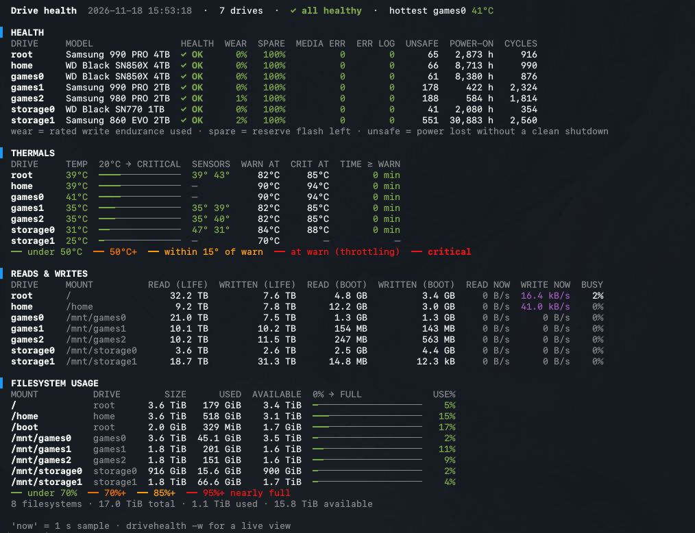

# drivehealth

I got tired of running smartctl on every drive one at a time and digging through the output, so I wrote this. It's one Python script that shows SMART health, temps, reads and writes and disk space for every drive in the machine on one screen. There's also a live mode if you want to leave it running while you copy stuff or game.



I run it on CachyOS with six NVMe drives and one SATA SSD. It should work on pretty much any Linux box with smartmontools.

## What you get

**Health.** Pass or fail, how much of the rated write endurance is used, spare flash, media errors, error log entries, unsafe shutdowns, power on hours and power cycles. If a drive needs a look it tells you why underneath the table.

**Thermals.** Current temp with a little bar, any extra sensors the drive has, and the warning and critical temps the drive reports. Colors go off each drive's own limits, not one number for everything. Watch mode also keeps the hottest temp seen since you started it.

**Reads and writes.** Lifetime totals from SMART, totals since boot, and what it's reading and writing right now.

**Filesystem usage.** Size, used and free for every mounted filesystem on those drives, which drive it's on, and a bar that goes green to red as it fills up.

## What it needs

Python 3, smartmontools, lsblk (util-linux) and sudo. That's it, no pip stuff.

For SATA temps without root you need the drivetemp kernel module loaded. NVMe temps work either way.

## Install

```bash
git clone https://github.com/orlfman/drivehealth.git
cd drivehealth
install -Dm755 drivehealth ~/.local/bin/drivehealth
```

Or just symlink it somewhere in your PATH if you want to keep pulling updates.

## Using it

```bash
drivehealth            # one snapshot
drivehealth -w         # live view, refreshes every 2 seconds
drivehealth -w 5       # live view, every 5 seconds
drivehealth --no-sudo  # skip SMART, just temps, I/O and disk space
```

It asks for your sudo password once when it starts. Only the smartctl reads run as root, everything else runs as you. If you don't give it a password it still shows everything it can without SMART.

In watch mode it only reads SMART about every 30 seconds. Every sudo call writes a few lines to the system journal, and SMART numbers barely move anyway, so there's no point hammering it every 2 seconds. Temps, I/O and disk space still update every refresh.

A few things worth knowing:

* Wear and the other vendor counters on SATA drives only get shown if smartctl knows your model. Vendors reuse the same attribute numbers for totally different things, so guessing just gives you wrong numbers.
* If a drive gets pulled or swapped while watch mode is running, it won't mix the old drive's numbers with the new one.
* UNSAFE counts every time the drive lost power without a clean shutdown, so it just keeps going up over the years. My old 860 EVO is at 551 and it's fine. Don't panic over that one.

## Tests

```bash
python3 tests/test_drivehealth.py
python3 tests/test_audit.py
```

They feed the script fake smartctl, lsblk and sensor output, so they don't need root and don't touch your drives.

## License

GPL 3.0, see LICENSE.
